# CiberEscape — Writeup completo

> ⚠️ **SPOILERS.** Aquí se resuelven los cinco desafíos paso a paso, con todas las respuestas. Si vas a jugar, hazlo antes: https://unfantasmaenelsistema.github.io/CiberEscape/

**Dificultad:** iniciación · **Duración orientativa:** 30–60 min · **Herramientas:** solo un navegador (y, si quieres, una terminal).

| # | Desafío | Técnica | Dónde está la pista |
|---|---|---|---|
| 1 | Criptografía: hashes | Revisar el código fuente + ataque de diccionario contra MD5 | Comentario HTML al final de `index.html` |
| 2 | Búsqueda de vulnerabilidades | Investigar un CVE a partir de un producto y una versión | Enunciado del desafío (banner de Exchange) |
| 3 | Codificación | Encontrar un script externo y decodificar Base64 | `js/telemetry.js` |
| 4 | Debilidades comunes | Clasificar una vulnerabilidad con su código CWE | Nota del desarrollador en `js/telemetry.js` |
| 5 | Fallo de configuración | Leer `robots.txt` y acceder a una copia «escondida» | `robots.txt` → `backup/config.txt` |

---

## 0. Primer vistazo

Al abrir la web aparece el **centro de comando**: una barra de progreso de cinco tramos, un cronómetro, el contador de pistas extra y el desafío actual. Arriba está el botón de la **herramienta de cracking**, que necesitaremos en el desafío 1.

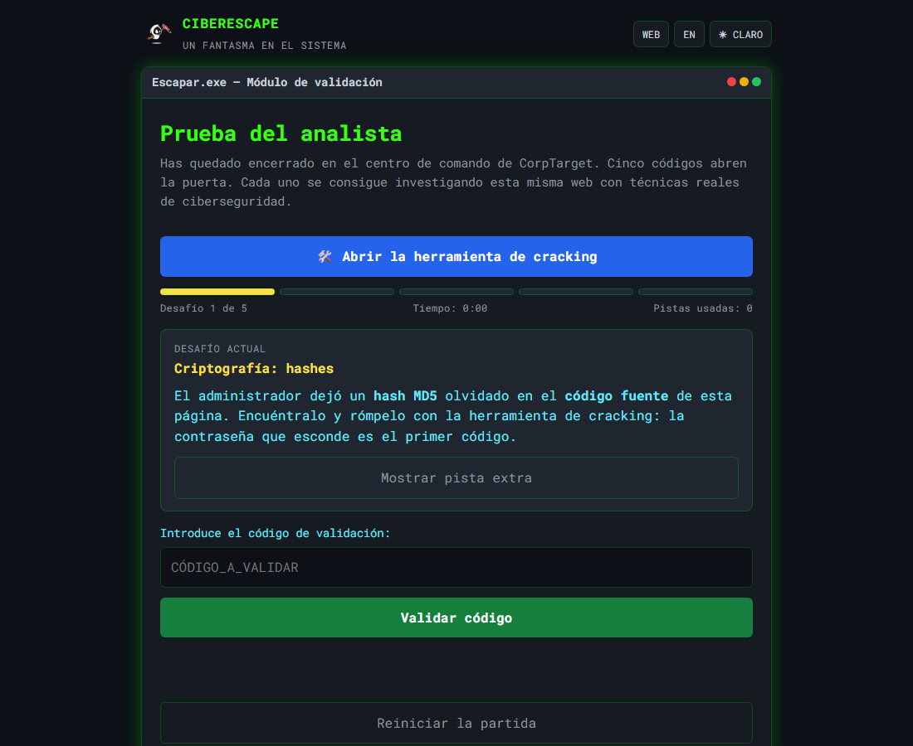

Detalles útiles antes de empezar:

- Los códigos no distinguen mayúsculas de minúsculas y se ignoran los espacios de los extremos (`s3curity10` vale igual que `S3CURITY10`).
- Cada desafío tiene una **pista extra** opcional. Usarla no penaliza, pero queda registrada al final junto con el tiempo.
- El progreso se guarda en el navegador (`localStorage`). El botón **Reiniciar la partida** lo borra.

Si introduces un código incorrecto, la web te lo dice sin dar más información:

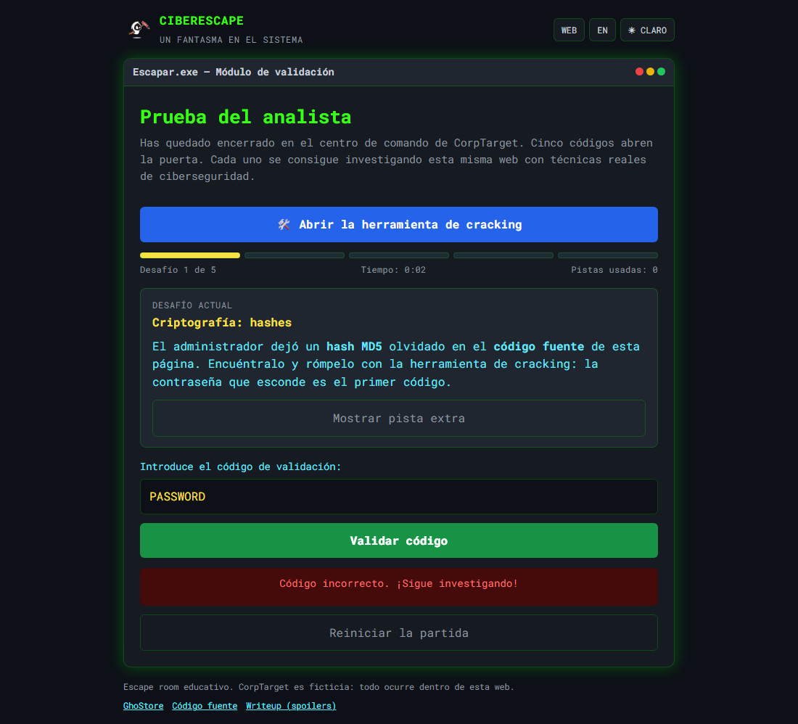

---

## 1. Criptografía: hashes → `S3CURITY10`

**Enunciado:** el administrador dejó un hash MD5 olvidado en el código fuente de esta página.

### 1.1 Encontrar el hash

El código fuente de una página es público: el navegador lo descarga entero para poder pintarla. Basta con:

- **Ctrl+U** (o clic derecho → *Ver código fuente de la página*), o
- **F12** → pestaña *Elementos*, aunque los comentarios que van fuera de `<body>` se ven mejor en el código fuente.

Al final del documento, después de `</body>`, hay un comentario HTML que alguien olvidó quitar:

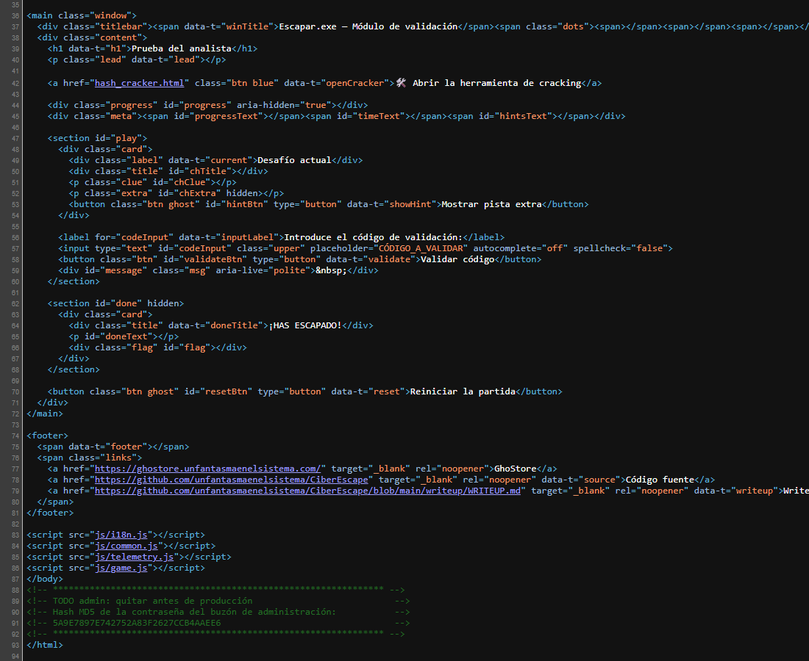

```html
<!-- TODO admin: quitar antes de producción                           -->
<!-- Hash MD5 de la contraseña del buzón de administración:           -->
<!-- 5A9E7897E742752A83F2627CCB4AAEE6                                 -->
```

**Cómo reconocer un MD5:** son 32 caracteres hexadecimales (0-9, A-F), es decir, 128 bits. SHA-1 tiene 40 y SHA-256 tiene 64.

### 1.2 Romper el hash

Un hash **no se descifra**: MD5 es una función resumen de un solo sentido. Lo que hace cualquier herramienta de cracking es **adivinar**: calcular el MD5 de muchas palabras candidatas y compararlo con el objetivo. Si coincide, esa palabra es la contraseña.

En la herramienta de cracking:

1. Pega el hash en **Hash MD5 objetivo**.
2. Pulsa **Lanzar ataque de diccionario**. La herramienta calcula el MD5 de las 152 contraseñas de `wordlist.txt` y las compara una a una.

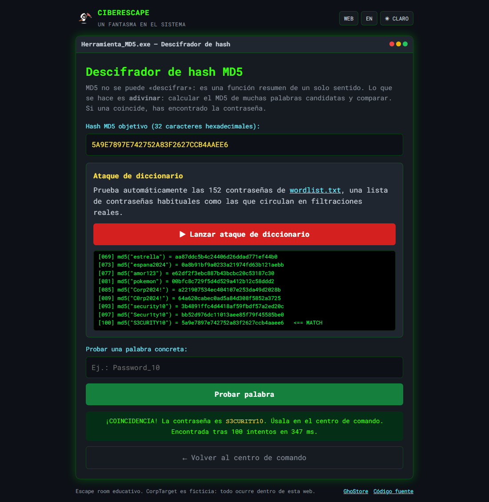

En el intento 100 aparece la coincidencia:

```
[100] md5("S3CURITY10") = 5a9e7897e742752a83f2627ccb4aaee6   <== MATCH
```

**Código 1: `S3CURITY10`**

### 1.3 Lo mismo fuera del navegador

Con herramientas reales, el ataque sería:

```bash
echo -n 'S3CURITY10' | md5sum                 # comprobar un candidato
hashcat -m 0 -a 0 hash.txt wordlist.txt       # modo 0 = MD5, ataque de diccionario
john --format=raw-md5 --wordlist=wordlist.txt hash.txt
```

El `-n` de `echo` importa: sin él, el salto de línea final entra en el hash y el resultado es otro.

### 1.4 Lección

- **Nunca dejes secretos en el código del cliente**, ni siquiera en comentarios: todo lo que llega al navegador es público.
- **MD5 no sirve para guardar contraseñas.** Es rapidísimo (aquí: 100 intentos en unos 350 ms en JavaScript; una GPU con hashcat prueba miles de millones por segundo) y no lleva sal. Para contraseñas se usan funciones lentas y con sal: **bcrypt, scrypt o Argon2id**.
- La contraseña `S3CURITY10` parece «compleja» (mayúsculas, número, sustitución 3→E), pero las sustituciones *leet* están en todos los diccionarios y reglas de cracking.

---

## 2. Búsqueda de vulnerabilidades (CVE) → `CVE-2021-26855`

**Enunciado:** el servidor de correo muestra el banner `Microsoft Exchange Server 2019 CU8`, sin parches desde 2020. Hay que encontrar el CVE de la vulnerabilidad **SSRF** que abrió la cadena **ProxyLogon** en marzo de 2021.

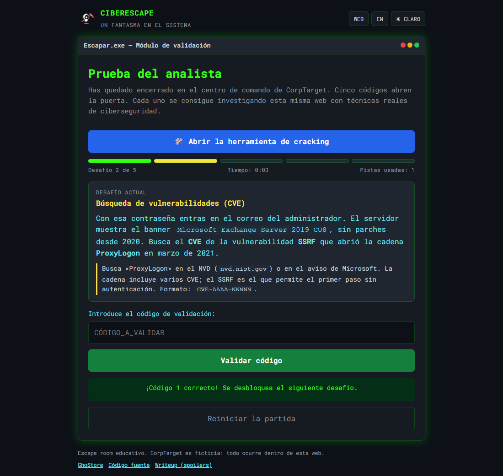

### 2.1 Investigación

1. Buscar «ProxyLogon» lleva a la campaña de marzo de 2021 contra Exchange on-premises: cuatro vulnerabilidades encadenadas que Microsoft parcheó de urgencia el 2 de marzo de 2021.
2. Los cuatro CVE de la cadena son:

| CVE | Tipo | Papel en el ataque |
|---|---|---|
| **CVE-2021-26855** | **SSRF** (*Server-Side Request Forgery*, CWE-918) | Primer paso: sin autenticación, el atacante hace que Exchange envíe peticiones en su nombre y se autentique como el propio servidor |
| CVE-2021-26857 | Deserialización insegura en Unified Messaging | Ejecución de código como SYSTEM |
| CVE-2021-26858 | Escritura arbitraria de ficheros (tras autenticarse) | Dejar una webshell |
| CVE-2021-27065 | Escritura arbitraria de ficheros (tras autenticarse) | Dejar una webshell |

3. En el NVD (`nvd.nist.gov`), la ficha de CVE-2021-26855 confirma el producto y la gravedad: CVSS 3.x de **9.8 crítico**, explotable por red, sin privilegios y sin interacción del usuario.

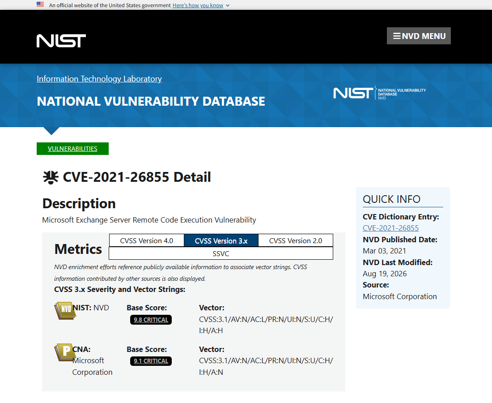

> **Ojo al título:** Microsoft llama a todos los CVE de la cadena «Remote Code Execution Vulnerability» y el NVD reproduce ese título. Lo que distingue a CVE-2021-26855 como **el SSRF** es su clasificación **CWE-918** y su papel en la cadena: es el único que se explota **sin autenticación**. Leer solo el título lleva a confusión; hay que leer la ficha entera.

**Código 2: `CVE-2021-26855`**

### 2.2 Lección

- Un **banner con la versión exacta** es reconocimiento gratis para un atacante: con producto y versión, la lista de CVE aplicables sale en minutos.
- ProxyLogon se explotó de forma masiva **antes y justo después** del parche: los servidores sin actualizar quedaron comprometidos en días. Parchear rápido los servicios expuestos a Internet no es opcional.
- Formato del identificador: `CVE-AÑO-NÚMERO`. El año es el de asignación, no necesariamente el de publicación.

---

## 3. Codificación: Base64 → `APIKEY_DECODE`

**Enunciado:** la página carga un script de telemetría externo con una clave de API «ofuscada».

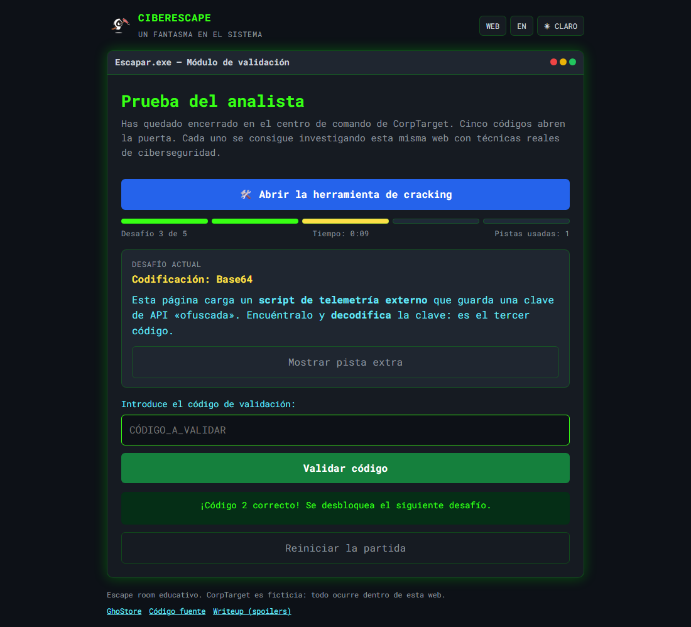

### 3.1 Encontrar el script

Hay varias formas:

- En el **código fuente** (Ctrl+U), al final aparecen las etiquetas `<script src="…">`. Una de ellas es `js/telemetry.js`.
- **F12 → Red (Network)**: recarga la página y aparecerán todas las peticiones, incluida `telemetry.js`.
- **F12 → Fuentes (Sources)**: el árbol de ficheros muestra `js/telemetry.js`.

Al abrir `js/telemetry.js` en el navegador:

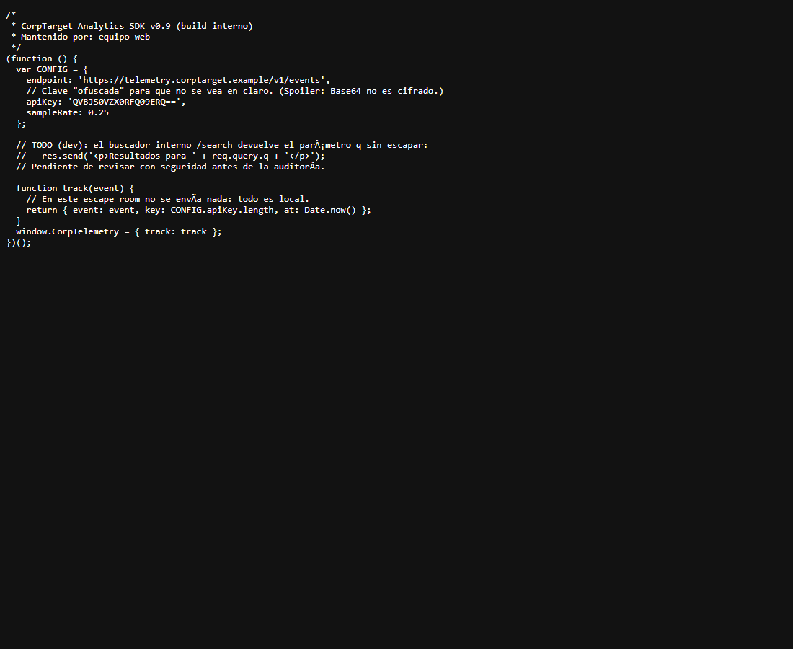

```js
apiKey: 'QVBJS0VZX0RFQ09ERQ==',
```

### 3.2 Decodificar

Pistas de que es **Base64**: solo usa `A-Z a-z 0-9 + /`, la longitud es múltiplo de 4 y termina en `=` o `==` de relleno.

- En la consola del navegador (F12 → Consola):
  ```js
  atob('QVBJS0VZX0RFQ09ERQ==')   // "APIKEY_DECODE"
  ```
- En una terminal:
  ```bash
  echo 'QVBJS0VZX0RFQ09ERQ==' | base64 -d
  ```
- O en CyberChef con la receta *From Base64*.

**Código 3: `APIKEY_DECODE`**

### 3.3 Lección

**Base64 es una codificación, no un cifrado.** No tiene clave: cualquiera lo revierte en un segundo. Las claves de API que llegan al navegador hay que considerarlas **públicas**, así que deben tener permisos mínimos o vivir solo en el servidor. Codificar un secreto en Base64 solo sirve para dar una falsa sensación de seguridad.

---

## 4. Debilidades comunes (CWE) → `CWE-79`

**Enunciado:** en el mismo script hay una nota: el buscador devuelve el parámetro `?q=` dentro de la página sin escapar. ¿Qué CWE identifica una XSS reflejada?

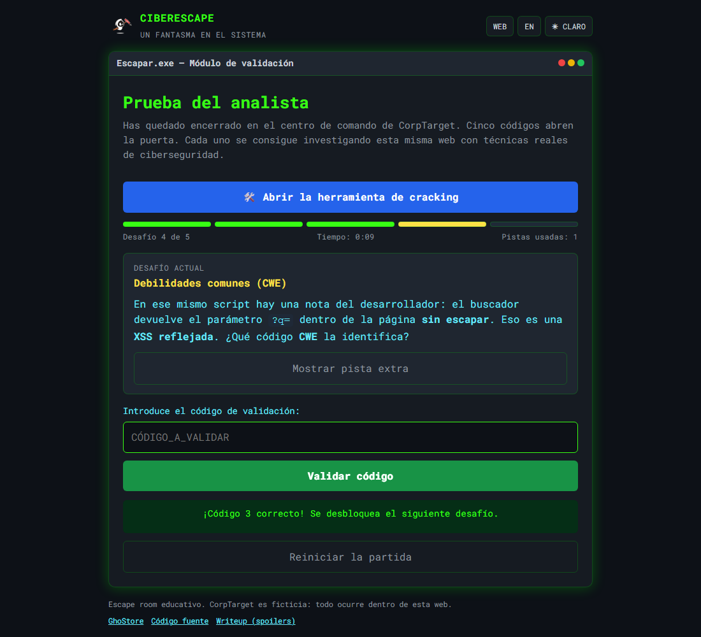

La nota del desarrollador en `js/telemetry.js` (visible en la captura del apartado 3):

```js
// TODO (dev): el buscador interno /search devuelve el parámetro q sin escapar:
//   res.send('<p>Resultados para ' + req.query.q + '</p>');
```

### 4.1 Análisis

El servidor mete lo que llega en `q` directamente en el HTML de la respuesta. Si alguien envía a una víctima un enlace como `/search?q=<script>…</script>`, ese código se ejecuta en el navegador de la víctima con la sesión de la víctima: eso es una **XSS reflejada** (el *payload* va y vuelve en la misma petición).

### 4.2 Clasificación

**CVE** identifica una vulnerabilidad concreta en un producto concreto. **CWE** (*Common Weakness Enumeration*, de MITRE) clasifica el **tipo de fallo**. Buscando «Cross-site Scripting» en `cwe.mitre.org`:

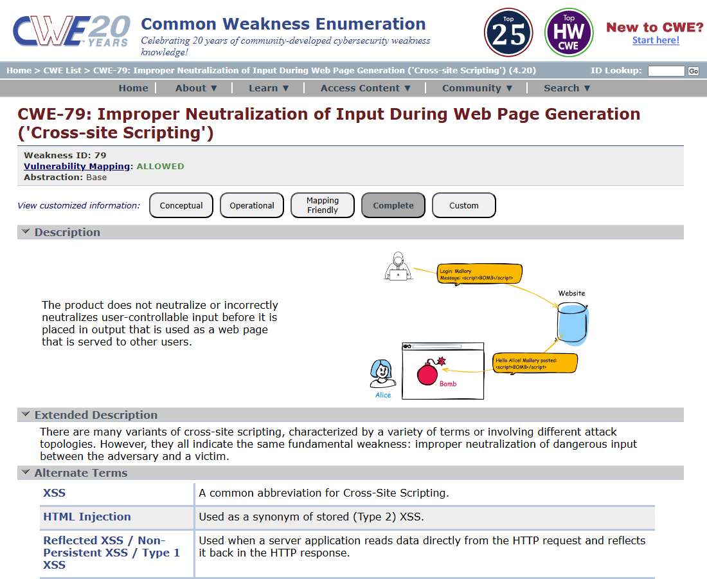

**CWE-79: Improper Neutralization of Input During Web Page Generation ('Cross-site Scripting').** Cubre las XSS reflejadas, almacenadas y basadas en DOM.

**Código 4: `CWE-79`**

### 4.3 Lección

- La corrección es **codificar la salida según el contexto** (en HTML: `&lt;` en lugar de `<`, etc.), usar plantillas que escapen por defecto y añadir una **Content-Security-Policy** como segunda barrera.
- La propia herramienta de cracking de este escape room estaba expuesta a lo mismo en la versión original (insertaba la palabra probada con `innerHTML`). Ahora la palabra se inserta como texto con `textContent`.
- CWE-79 encabeza o ronda el primer puesto del *CWE Top 25* de MITRE año tras año.

---

## 5. Fallo de configuración → `CONFIG_FAIL`

**Enunciado:** el administrador pidió a los buscadores que no indexaran una copia de seguridad y lo dejó escrito en un fichero público estándar de la raíz de la web.

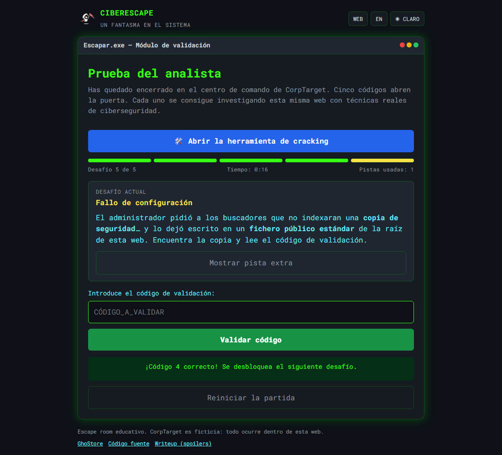

### 5.1 robots.txt

`robots.txt` es el fichero estándar con el que una web indica a los rastreadores qué rutas no deben indexar. Está siempre en la raíz y cualquiera puede leerlo. Abrimos `robots.txt`:

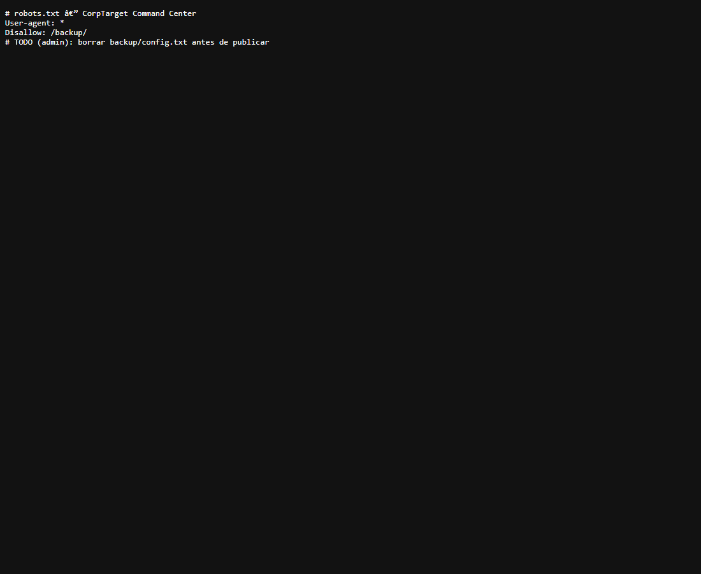

```
User-agent: *
Disallow: /backup/
# TODO (admin): borrar backup/config.txt antes de publicar
```

> En GitHub Pages esta web vive en `/CiberEscape/`, así que la «raíz» del reto es `https://unfantasmaenelsistema.github.io/CiberEscape/robots.txt` y la copia está en `…/CiberEscape/backup/config.txt`.

### 5.2 La copia de seguridad

Abrimos `backup/config.txt`:

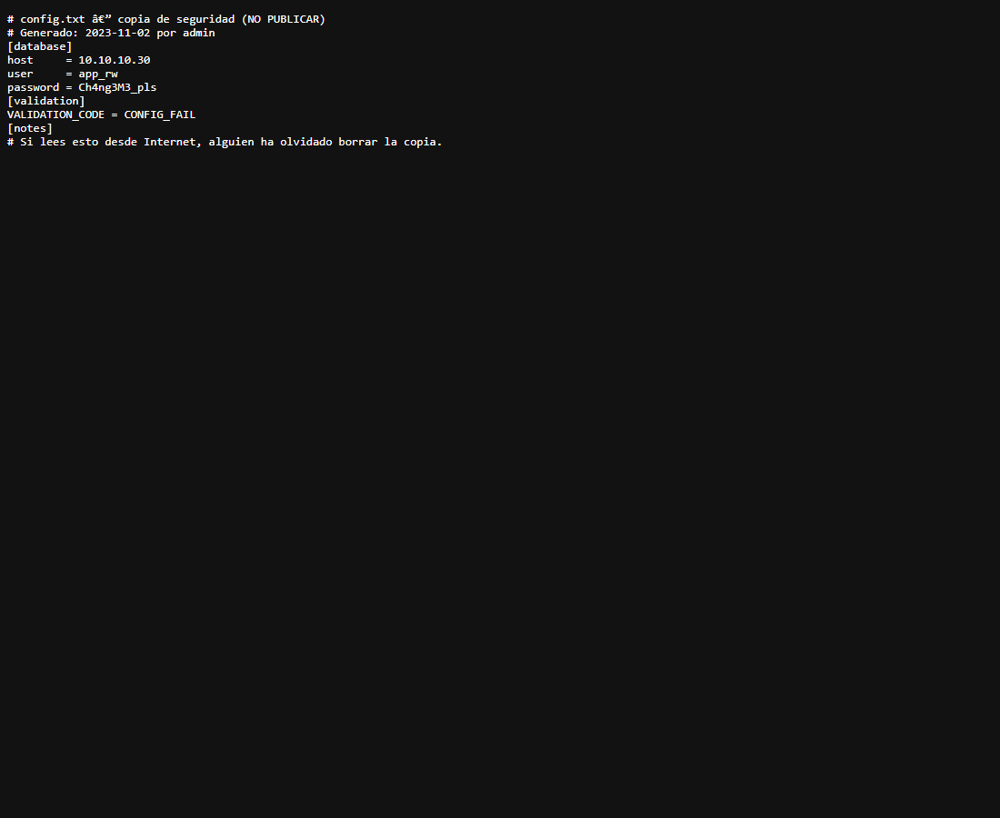

```ini
[database]
host     = 10.10.10.30
user     = app_rw
password = Ch4ng3M3_pls
[validation]
VALIDATION_CODE = CONFIG_FAIL
```

Además del código, la copia filtra **credenciales de base de datos**. En un caso real, eso sería el hallazgo grave.

**Código 5: `CONFIG_FAIL`**

### 5.3 Lección

- `robots.txt` **no es un control de seguridad**: es una petición de cortesía que los buscadores honrados respetan y que cualquier atacante lee primero. Listar ahí rutas «secretas» es poner un cartel señalándolas.
- Las copias de seguridad, ficheros `.bak`, `.old`, `.env`, `config.*` o directorios `.git` no deben estar en la raíz web. Herramientas como `gobuster`, `ffuf` o `dirsearch` los encuentran por fuerza bruta aunque no aparezcan en `robots.txt`.
- Esta categoría es **A05: Security Misconfiguration** en el OWASP Top 10 (2021).

---

## 6. Final

Con el quinto código se abre la puerta y aparece la bandera maestra, junto con el tiempo y las pistas usadas:

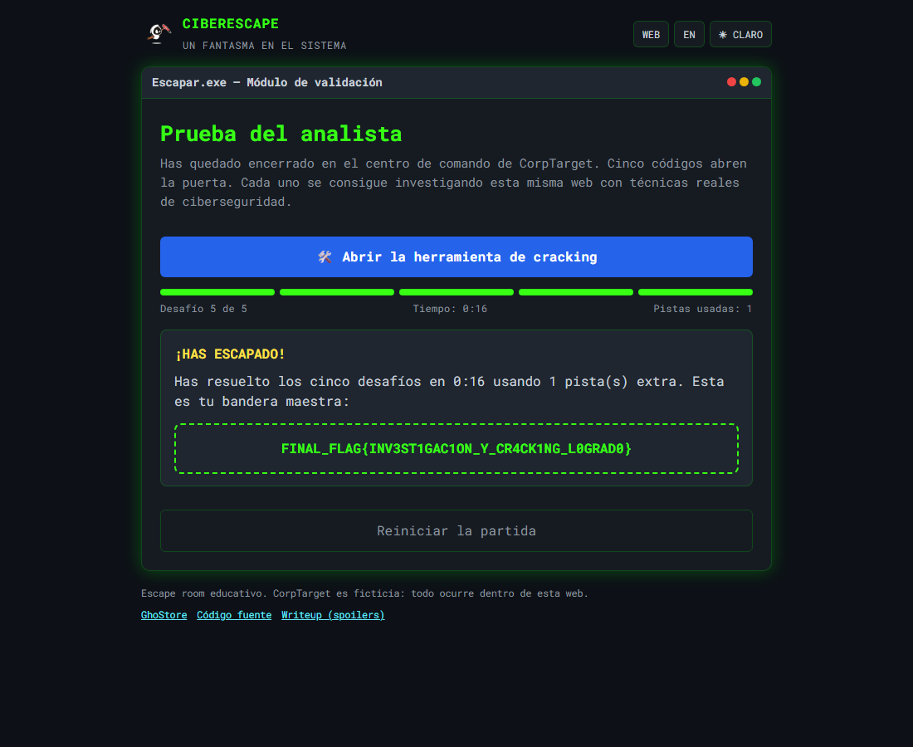

```
FINAL_FLAG{INV3ST1GAC1ON_Y_CR4CK1NG_L0GRAD0}
```

### ¿Por qué no se puede sacar la bandera del código fuente?

En la versión original, la bandera y las cinco respuestas estaban en claro en el JavaScript: bastaba con Ctrl+U para ganar. Ahora:

- Las respuestas se guardan solo como **SHA-256**. La web calcula el SHA-256 de lo que escribes y lo compara: comprueba sin revelar.
- La bandera va **cifrada (XOR)** con una clave derivada del SHA-512 de las cinco respuestas unidas. Sin las cinco respuestas no hay clave, y sin clave la bandera es ruido.

Es un buen ejemplo de la diferencia entre **ocultar** un secreto (lo que hacían el comentario HTML, el Base64 y el `robots.txt`) y **protegerlo** con criptografía bien usada.

---

## Resumen de respuestas

| # | Código |
|---|---|
| 1 | `S3CURITY10` |
| 2 | `CVE-2021-26855` |
| 3 | `APIKEY_DECODE` |
| 4 | `CWE-79` |
| 5 | `CONFIG_FAIL` |
| 🏁 | `FINAL_FLAG{INV3ST1GAC1ON_Y_CR4CK1NG_L0GRAD0}` |

---

## Guía para docentes

- **Formato:** individual o por parejas, 30–60 minutos. Funciona en cualquier navegador; no requiere instalar nada ni conexión con servidores externos (salvo la investigación del CVE y del CWE).
- **Modo aula:** las pistas extra pueden imprimirse y repartirse en sobres. El contador de pistas y el cronómetro sirven para desempatar.
- **Reinicio entre grupos:** botón *Reiniciar la partida* (borra el progreso guardado en ese navegador).
- **Debate posterior sugerido:**
  1. ¿Qué diferencia hay entre codificar, hacer un hash y cifrar? (desafíos 1, 3 y final)
  2. ¿Por qué MD5 y SHA-256 «a secas» no sirven para contraseñas?
  3. CVE frente a CWE: ¿qué identifica cada uno?
  4. Seguridad por oscuridad: comentario HTML, Base64, `robots.txt`. ¿Qué tienen en común?
- **Ejecutar en local:** `python -m http.server` en la carpeta del repositorio y abrir `http://localhost:8000`. El ataque de diccionario necesita servidor para cargar `wordlist.txt`.
